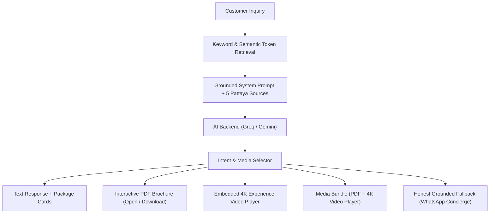

# Greedy Adventures — AI Experience Concierge & Sea View Skydiving Platform

A production-grade, full-stack Next.js + TypeScript web application and AI Concierge for **Greedy Adventures — Sea View Skydiving (Pattaya, Thailand)**.

Built with **Next.js (App Router)**, **TypeScript**, **Tailwind CSS**, **Groq Ultra-Fast Inference Backend** (with Google Gemini fallback), **Zod schema validation**, and accessible interactive UI components.

- **Production Prototype**: [Sea View Skydiving Experience](http://localhost:3000)
- **Knowledge View URL**: [http://localhost:3000/knowledge](http://localhost:3000/knowledge)

---

## 1. Requirement Compliance Matrix

| Requirement | Implementation Details | Status |
| :--- | :--- | :---: |
| **Next.js + TypeScript Page** | Built on Next.js 16 (App Router) + TypeScript in strict mode (`tsc --noEmit` clean). Full Sea View Skydiving experience with hero, packages, jump dynamics, FAQ, and footer. | **PASSED** |
| **Clean Premium Redesign** | Warm Ivory (`#FAF9F3`), coastal deep navy (`#0B1422`), champagne gold (`#B88E3E`), and maritime teal. Fully responsive and keyboard-accessible. | **PASSED** |
| **Chat Interface & AI Backend** | Conversational chat interface with multi-turn memory, grounded strictly in Pattaya dropzone knowledge. Powered by **Groq** (`openai/gpt-oss-120b` / `qwen/qwen3.8-27b`) for ultra-fast sub-second responses, with Google Gemini fallback. | **PASSED** |
| **Intent-Based Format Selection** | • Text question -> Text answer + structured package comparison cards.<br>• Brochure question -> PDF Card with Open & Download buttons.<br>• Video question -> Playable experience video with watch link.<br>• Combined question -> `media_bundle` sharing both PDF and video. | **PASSED** |
| **Demo Material Tagging** | Sample PDF brochure and video links clearly marked with **DEMO MATERIAL** tags. | **PASSED** |
| **Anti-Hallucination & Error Handling** | Strict ground-truth boundaries. Refuses out-of-scope queries (e.g. Paris helicopter tours). Honest fallback and loading/error states without faking AI responses. | **PASSED** |
| **Read-Only Knowledge View** | Accessible directly via URL (`/knowledge`). Shows all grounded website sources, capture dates, passage text, whitelisted PDFs & videos. | **PASSED** |
| **Live Pipeline Inspector** | Live tester at `/knowledge` displaying real-time retrieval passages, injected prompt, model response, and selected media. Zero mock data. | **PASSED** |
| **Code Architecture & Security** | Strict separation of UI, knowledge, AI backend, media handling, and Zod validation. API keys kept strictly server-side. | **PASSED** |

---

## 2. Architecture & Code Structure

```text
greedy/
├── src/
│   ├── app/
│   │   ├── api/
│   │   │   ├── chat/route.ts            # Validated chat endpoint (Zod + RAG + Groq/Gemini + Media)
│   │   │   ├── knowledge/route.ts       # Live sources & media metadata endpoint
│   │   │   └── knowledge-test/route.ts  # Real-time retrieval inspector endpoint
│   │   ├── knowledge/
│   │   │   └── page.tsx                 # Direct URL /knowledge dashboard (Sources, Media, Tester)
│   │   ├── globals.css                  # Custom scrollbars, glassmorphism, animations
│   │   ├── layout.tsx                   # Root layout with fonts & suppressHydrationWarning
│   │   └── page.tsx                     # Main Sea View Skydiving page with ChatWidget
│   ├── components/
│   │   ├── chatbot/
│   │   │   ├── ChatWidget.tsx           # Floating luxury launcher & responsive modal
│   │   │   ├── ChatHeader.tsx           # Concierge header, online indicator, New Chat reset
│   │   │   ├── ChatMessages.tsx         # Conversation history, markdown, auto-scroll
│   │   │   ├── ChatMessage.tsx          # Assistant (ivory) and user (navy) bubbles + markdown
│   │   │   ├── ChatInput.tsx            # Accessible auto-resizing input with keyboard shortcuts
│   │   │   ├── PackageCard.tsx          # Structured interactive skydiving package cards
│   │   │   ├── PackageComparison.tsx    # Multi-card package comparisons
│   │   │   ├── MediaAttachmentCard.tsx  # PDF Card with Open & Download (DEMO MATERIAL)
│   │   │   ├── VideoPlayer.tsx          # 4K Video player with inline playback & YouTube link
│   │   │   ├── SourceCitations.tsx      # Ground-truth source citation chips with URLs
│   │   │   ├── SuggestedQuestions.tsx   # Clickable follow-up prompt suggestion chips
│   │   │   ├── TypingIndicator.tsx      # Natural pulsing typing indicator
│   │   │   ├── ErrorMessage.tsx         # Honest connection & retry card
│   │   │   └── WelcomeScreen.tsx        # Initial concierge welcome with quick action chips
│   │   ├── knowledge/
│   │   │   ├── KnowledgeDashboard.tsx   # Read-only dashboard container with tabs
│   │   │   ├── SourceList.tsx           # Tab 1: 5 Ground-truth website sources & passages
│   │   │   ├── MediaLibrary.tsx         # Tab 2: PDF & Video library with embedded preview
│   │   │   └── RetrievalInspector.tsx   # Tab 3: Real-time query test console & pipeline inspector
│   │   ├── Navbar.tsx                   # Responsive luxury navigation bar
│   │   └── HomePage.tsx                 # Full luxury Sea View Skydiving landing page
│   └── lib/
│       ├── ai/
│       │   ├── groq.ts                  # Ultra-fast Groq API client (<1s latency)
│       │   ├── gemini.ts                # Server-side Gemini service & multi-model fallback
│       │   └── prompts.ts               # Grounding system prompt & anti-hallucination rules
│       ├── knowledge/
│       │   ├── sources.ts               # 5 Ground-truth website documents & metadata
│       │   └── retrieval.ts             # Keyword & token RAG retrieval engine + citations
│       ├── media/
│       │   └── media-selector.ts        # Intent parser (text, pdf, video, media_bundle)
│       └── validation/
│           └── chat-schema.ts           # Zod validation schemas for requests & responses
├── public/
│   └── media/
│       └── demo-skydiving-brochure.pdf  # Real accessible PDF brochure (1.7 KB)
├── .env.local                           # Server-side API keys
├── .env.example                         # Environment configuration template
└── README.md
```

---

## 3. Quick Start & Setup

### Prerequisites
- Node.js 18+ or 20+
- npm or pnpm

### 1. Environment Variables
Create or update `.env.local` in the project root:
```env
# Groq API Key (Primary Ultra-Fast Inference Backend)
GROQ_API_KEY=your_groq_api_key_here
GROQ_MODEL=openai/gpt-oss-120b

# Google Gemini API Key (Fallback Backend)
GEMINI_API_KEY=your_gemini_api_key_here
GEMINI_MODEL=gemini-2.5-flash
```

> **Security Guarantee**: All API keys are accessed exclusively in server-side Next.js route handlers (`src/lib/ai/groq.ts` and `src/lib/ai/gemini.ts`). Keys are never bundled or exposed to the client browser.

### 2. Install & Run
```bash
npm install
npm run dev
```
Open **[http://localhost:3000](http://localhost:3000)** in your browser.

---

## 4. Agent Flow & Intent Selection



### The 4 Response Types:
1. **`text`**: Standard questions (e.g. *"What packages do you offer?"* or *"What is included in ECO?"*). Returns grounded text, structured package comparison cards, and clickable source links.
2. **`pdf`**: Brochure questions (e.g. *"Can you send me a brochure?"*). Returns message + interactive `MediaAttachmentCard` with **Open PDF** (new tab) and **Download** actions.
3. **`video`**: Footage questions (e.g. *"Can I see a video of the experience?"*). Returns message + interactive `VideoPlayer` with inline play and external watch link.
4. **`media_bundle`**: Combined questions (e.g. *"Send me the brochure and a video"*). Returns message + both the PDF Card and the 4K Video Player together.

---

## 5. How to Open the Knowledge View

The knowledge view is intentionally unlisted from the public homepage navigation to keep customer-facing landing pages clean and executive.

To access the Knowledge View:
* Enter the direct URL in your browser:
  ```text
  http://localhost:3000/knowledge
  ```
* **Tab 1 — Knowledge Sources**: View all 5 grounded website sources, capture dates, URLs, and exact text passages.
* **Tab 2 — Media Library**: Inspect verified PDF and Video assets with embedded interactive document viewers.
* **Tab 3 — Concierge Response Tester**: Live query runner testing real-time retrieval, injected prompts, and actual model outputs with zero mock data.

---

## 6. Verification Steps & Repeatable Checks

Run through these step-by-step checks to verify all functionality:

| # | Test Scenario | Input Prompt | Expected Verification Result |
| :--- | :--- | :--- | :--- |
| **1** | **Package Inclusions** | *"What is included in the ECO package?"* | Answers ฿9,500 THB, 13,000 FT jump, briefing, certificate; confirms photos/videos **NOT** included; provides source citations. |
| **2** | **Multi-Turn Follow-Up** | 1. *"Which package includes 4K video?"*<br>2. *"What about its price?"* | Assistant identifies DELUXE (4K Handcam) and VIP (Freefall Cameraman); on step 2, understands "its" refers to the previously mentioned packages and states ฿12,500 / ฿14,000 THB. |
| **3** | **PDF Brochure Request** | *"Can you send me a brochure?"* | Returns `responseType: "pdf"` with interactive PDF card, Open PDF, and Download buttons labeled `DEMO MATERIAL`. |
| **4** | **Video Request** | *"Can I see a video of the experience?"* | Returns `responseType: "video"` with embedded 4K skydiving video player. |
| **5** | **Combined Media Bundle** | *"Send me the brochure and a video"* | Returns `responseType: "media_bundle"` and renders **both** PDF Card and Video player simultaneously. |
| **6** | **Anti-Hallucination & Out-of-Scope** | *"Do you offer helicopter tours in Paris?"* | Strictly refuses out-of-scope question and directs customer to the WhatsApp concierge (`+66800948586`). |
| **7** | **New Chat Reset** | Click the reset icon in the chat header | Conversation history resets cleanly to the initial welcome screen. |
| **8** | **Live Inspector Check** | Test any prompt in `/knowledge` | Displays real-time model output, retrieved sources, and selected media without hardcoded data. |

---

## 7. Open-Source Component Credits & Reused Work

- **Icons**: [Lucide React](https://lucide.dev)
- **Typography**: [Google Fonts](https://fonts.google.com) (Plus Jakarta Sans & Cormorant Garamond)
- **CSS Utility**: [Tailwind CSS v4](https://tailwindcss.com)
- **Validation**: [Zod](https://zod.dev)
- **Inference**: [Groq Cloud API](https://groq.com) & [Google Generative AI](https://ai.google.dev)

---

## 8. Limitations & Prototype Boundaries

- **Prototype Scope**: As requested in the specification, bookings, payments, user authentication, customer databases, and live web crawlers are not implemented.
- **Demo Content**: The brochure PDF (`/media/demo-skydiving-brochure.pdf`) is sample demo material labeled with `DEMO MATERIAL`.
- **AI Assistance**: Built in collaboration with agentic AI pair programming tools, thoroughly reviewed, tested, and validated with zero compilation errors (`tsc --noEmit`).
